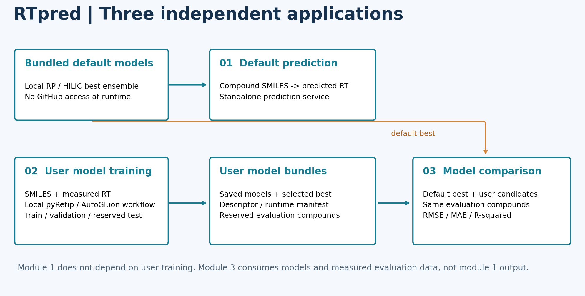
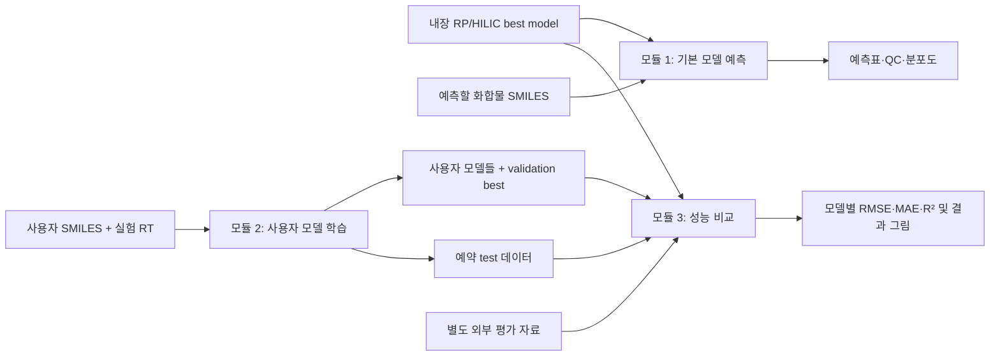
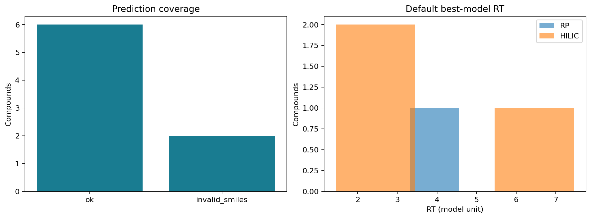
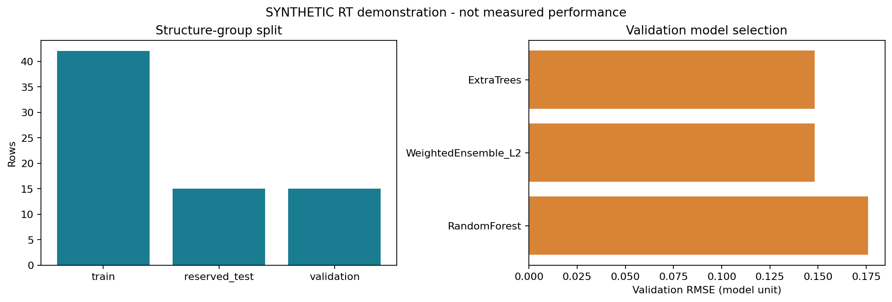
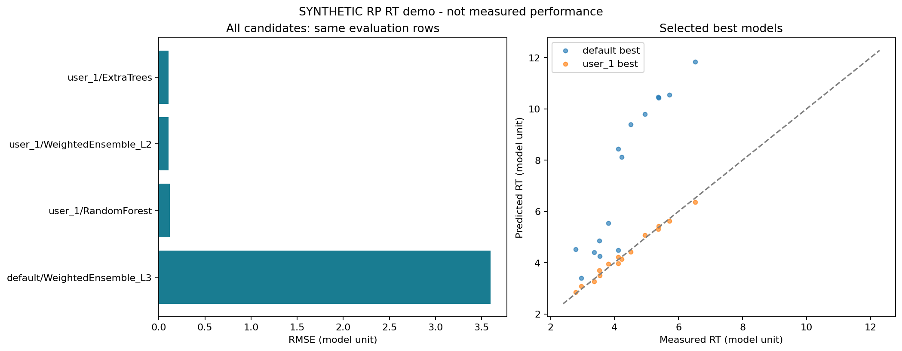

# CLOSHA 3.0 콘텐츠 제출 명세 — 기능별 3개 모듈

## 1–5. 파이프라인 기본 정보

아래는 RTpred 파이프라인의 등록 및 사용자 안내 문안입니다.

| 요청 항목 | 제출 내용 |
|---|---|
| 1. 파이프라인 명 | **RTpred** |
| 2. 카테고리 | 대사체 분석 / 화학정보학 / 머신러닝 (운영기관 분류체계에 매핑할 제안값) |
| 3. 키워드 | Retention time, RP, HILIC, SMILES, RDKit, pyRetip, AutoGluon, Model training, Model comparison |
| 4. 부제목 | 내장 best model의 RT 예측부터 사용자 실험 자료 기반 모델 생성, 기본·사용자 모델 성능 비교까지 제공하는 분석 도구 |
| 5. 설명 | 화합물 구조로 RP/HILIC 머무름 시간을 예측합니다. 사용자는 내장 모델로 바로 예측하거나 자신의 RT 라이브러리로 새로운 모델을 생성할 수 있습니다. 별도의 평가 자료에서 기본 모델과 사용자 모델들을 동일한 기준으로 비교합니다. 각 기능은 독립 CLI·컨테이너·입출력을 가지며 실행 시 외부 저장소에 접속하지 않습니다. |

## 6. 기능·데이터 연결 흐름도



[PNG](images/pipeline_flow.png) / [SVG](images/pipeline_flow.svg)



모듈 1·2는 서로 독립입니다. 모듈 3에는 예약 test 또는 별도 외부 평가 자료 중 하나를 넣습니다. 모듈 1의 예측 결과는 모듈 3의 필수 입력이 아닙니다.

## 7. 모듈별 분석 개념 이미지

| 모듈 | 이미지 | 설명 |
|---|---|---|
| 1 기본 모델 예측 | [PNG](images/module1_concept.png) / [SVG](images/module1_concept.svg) | 입력 구조를 RDKit 특성으로 변환하여 저장된 best ensemble로 예측 |
| 2 사용자 모델 학습 | [PNG](images/module2_concept.png) / [SVG](images/module2_concept.svg) | 구조 그룹 분할, train 전용 특성 선택, pyRetip 학습 인터페이스, validation 기반 best 선택 |
| 3 성능 비교 | [PNG](images/module3_concept.png) / [SVG](images/module3_concept.svg) | 동일 평가 화합물에 대한 기본·사용자 후보 예측과 지표·순위 비교 |

모든 개념도는 이 패키지를 위해 직접 작성했으며 외부 논문 그림을 복제하지 않았습니다. `scripts/make_figures.py`로 재생성할 수 있습니다.

## 8. 입력표 작성 및 샘플 예시

공통 입력은 UTF-8 CSV 또는 XLSX이며 한 행은 한 화합물입니다. 생물학적 샘플 그룹·배치 메타데이터나 LC-MS raw 파일은 필요하지 않습니다. CSV 첫 행을 헤더로 작성하고 소수점은 `.`을 사용합니다. XLSX는 첫 시트 또는 `--sheet` 이름을 선택합니다. legacy `.xls`는 지원하지 않습니다.

| 열 | 모듈 1 | 모듈 2 | 모듈 3 | 규칙 |
|---|---|---|---|---|
| `SMILES` / `smiles` | 필수 열 | 필수 열 | 필수 열 | 분자 구조 문자열 |
| `model_type` | 조건부 필수 | 옵션 | 옵션 | `RP`/`HILIC`. `--model`과 동시에 제공하면 서로 같아야 함 |
| `RT` / `experimental_rt` | 옵션 | 필수 | 필수 | 0 이상 유한 숫자. 학습·평가에는 모든 행에 값 필요 |
| `compound_id`, `Name`, `InChIKey` | 옵션 | 옵션 | 옵션 | 추적용 정보. 식별자 문자열·선행 0 보존 |

`structure`, `Column`, `mode`, `chrom_system`, `retention_time` 별칭도 지원합니다. 같은 의미의 열을 두 개 제공하면 중단합니다. `row_id`, `parse_status`, `warning_message`, `predicted_rt`, `delta_rt`, `candidate`, `split`, `canonical_smiles`는 출력 예약 열입니다.

**모듈 1**: RT 없이도 예측합니다. RP/HILIC 혼합 입력이 가능하며 혼합 시 `--model`을 생략합니다. 잘못된/빈 SMILES는 행을 유지하고 예측값을 비워 둡니다.

```csv
compound_id,SMILES,model_type
C001,O=C(O)c1ccccc1,RP
C002,NCC(=O)O,HILIC
```

**모듈 2**: 한 실행당 RP 또는 HILIC 한 종류를 학습합니다. 실제 적용 시 같은 LC 조건·같은 RT 단위의 실험 라이브러리를 입력합니다. 아래 RT는 **형식 설명용 합성값**입니다.

```csv
compound_id,SMILES,RT
DEMO001,CCO,2.1
DEMO002,CCN,2.8
```

학습에는 정제 후 최소 25행·15개 고유 canonical 구조가 필요합니다. 이 두 행 예시는 형식 설명이며 실행 예제는 72행 CSV로 별도 제공합니다. 동일 canonical 구조·RT 중복은 제거합니다. 같은 구조의 반복 측정은 같은 split에 넣습니다. invalid SMILES는 `rejected_rows.csv`에 기록합니다.

**모듈 3**: SMILES와 실험 RT가 있는 평가 표 및 모듈 2가 만든 `model/` 디렉터리 전체를 입력합니다. 사용자 모델을 여러 개 전달할 수 있습니다. 사용자 모델 학습·validation에 사용한 구조와 겹치면 중단합니다. 기본 모델 학습 자료의 전체 구조 목록은 없어 기본 모델과의 학습 중복 여부는 `unknown`으로 표시합니다.

## 9. 모듈별 실행 요구사항

공통: Linux x86_64, Apptainer, 읽기 가능한 입력, 새 출력 디렉터리. 실행 중 인터넷·GPU·GitHub·conda는 필요하지 않습니다. 빌드 시에는 공식 OCI 이미지·Debian·PyPI 다운로드가 필요합니다. 보안기관에는 빌드된 SIF와 필요한 모델을 전달하여 오프라인 실행할 수 있습니다.

아래는 **초기 권장 할당량이며 성능 시험으로 확정한 최소 사양이 아닙니다**.

| 모듈 | CPU/RAM 권장 | 디스크·전제 |
|---|---|---|
| 1 | 2 CPU / 8 GB | 이미지 및 기본 모델 약 0.8 GB + 결과 공간 |
| 2 | 4 CPU / 16 GB | 사용자 데이터·후보 모델 저장을 위해 초기 10 GB 이상 권장; 입력 규모에 따라 증가 |
| 3 | 2 CPU / 8 GB | 기본 모델 + 사용자 모델들 + 결과 공간; 모델 묶음별 순차 평가 |

모듈 2 CLI 기본 CPU는 2이며 운영자 할당에 맞춰 `--cpus`를 지정합니다. GPU 0, bagging 0, stacking 0으로 명시하여 현재 CPU 모델군으로 학습합니다. 기본 후보는 LightGBM, CatBoost, RandomForest, ExtraTrees, KNeighbors이며 성공한 후보에 대해 weighted ensemble이 생성될 수 있습니다. 시간 제한 안에 모든 후보가 성공한다고 보장하지는 않습니다. 생성된 모델 목록은 leaderboard로 확인합니다.

## 10. 모듈별 결과 그림·설명

### 모듈 1: Prediction 
## (기생성된 best model을 default model로 하는 RT 예측 모듈)



| 파일 | 결과 의미 |
|---|---|
| `predictions.csv` | 입력 순서·행 ID를 유지한 예측표, `best_model`, 구조 해석 상태, 선택적 ΔRT |
| `prediction.png`, `.svg` | 처리 성공/실패 행 수, 모드별 RT 분포 |
| `report.html` | 그림과 처음 100행 미리보기·다운로드 링크 |
| `manifest.json` | 실제 best 이름, 모델 manifest 해시, 입력 해시·런타임 |

기본 예제 8행 중 6행은 예측되고 invalid 2행은 사유와 함께 남습니다. RP/HILIC best는 모두 `WeightedEnsemble_L3`입니다. ΔRT는 `experimental_rt - predicted_rt`입니다. 모델에서 반환한 RT를 임의 보정·단위 변환하지 않습니다.

### 모듈 2: Training 
## (사용자 데이터 기반의 학습 및 모델 생성)



그림은 **합성 RT 학습 예제**입니다. 왼쪽은 구조 그룹 기준 train/validation/reserved test 행 수, 오른쪽은 validation RMSE입니다. 이 예제의 숫자는 실제 측정 성능이 아닙니다.

| 파일 | 결과 의미 |
|---|---|
| `model/autogluon/` | 성공한 후보·앙상블 학습 결과, 추론 가능한 모델 묶음 |
| `model/model_manifest.json` | best 이름, 특성·전처리·런타임·RT 단위·학습/validation 구조 해시 |
| `model/selected_features.txt` | train에서 선택한 특성 목록 |
| `validation_leaderboard.csv` | 후보별 validation 성능. AutoGluon `score_val`은 **음의 RMSE**, 클수록 좋음 |
| `split_assignments.csv` | 각 행의 train/validation/reserved_test 배정 |
| `reserved_test.csv` | 학습·validation·best 선택에 사용하지 않은 평가용 표. 모듈 3 입력 가능 |
| `rejected_rows.csv` | invalid 구조 행 |
| `training.png`, `.svg`, `report.html` | 분할 현황과 후보 성능·best 설명 |
| `manifest.json` | 작업 요약 |

특성 필터는 train에만 fit합니다. validation RMSE로 best를 정하며 test 성능으로 best를 정하지 않습니다. test를 포함한 전체 자료 재학습도 하지 않습니다. 따라서 저장 best는 예약 test가 사용되지 않은 모델입니다.

### 모듈 3: Performance Comparing 
## (default 모델을 대조군으로 하는 사용자 모델 성능 비교)



그림은  예시입니다.

| 파일 | 결과 의미 |
|---|---|
| `comparison.csv` | 후보별 n, RMSE, MAE, R², 평가 자료에서의 순위, 학습 시 best 여부 |
| `predictions_long.csv` | 모든 후보의 행별 예측·RT 오차·invalid 상태 |
| `comparison.png`, `.svg` | 모든 후보 RMSE 막대 그래프 및 각 묶음 best의 관측/예측 산점도 |
| `report.html` | 비교표·그림·적용 한계·다운로드 링크 |
| `manifest.json` | 평가 입력·모델 해시, 평가 수, 기본 모델 학습 중복 미확인 표시 |

모든 후보는 동일한 유효 행으로 평가합니다. invalid 구조는 지표에서 제외하지만 long table에는 남습니다. R²는 관측값 분산이 0이면 계산하지 않고 CSV에 빈 값으로 기록합니다. `--scope all`은 **사용자 묶음의 추론 가능한 모든 후보**를 비교하며, 기본 모델은 내장 best 하나만 포함합니다. `--scope best`는 각 묶음의 best만 비교합니다. 이 순위가 저장 best나 default 모델을 자동 변경하지는 않습니다.

RT 단위·LC 조건이 달라진 모델 사이의 수치 비교는 조건을 맞춘 검증이 아닙니다. 사용자 RT 단위 문자열과 평가 단위가 다르면 중단하지만, 기관 기본 모델의 원래 단위·상세 조건은 제공 자료에서 확인되지 않았으므로 보고서에 명시합니다. 필요 시 학습 자료 제공자가 단위·컬럼·용매·gradient를 확인해야 합니다.

## 11. 모듈별 파라미터

| 모듈 | 인자 | 필수 여부 | 기본값·설명 |
|---|---|---|---|
| 공통 | `--input` | 필수 | 로컬 CSV/XLSX 파일 |
| 공통 | `--output` | 필수 | 새 폴더 또는 빈 폴더 |
| 공통 | `--model` | 1 조건부 / 2·3 필수 | RP/HILIC. 입력 열과 다르면 오류; 1은 입력 model_type이 있으면 생략 가능 |
| 공통 | `--sheet` | 옵션 | XLSX 시트명; 기본 첫 시트, CSV에는 미적용 |
| 공통 | `--help` | 옵션 | 사용법 표시 후 종료 |
| 2·3 | `--rt-unit` | 옵션 | `model unit`; 표시·메타데이터 단위. 수치 변환 없음 |
| 2 | `--time-limit` | 옵션 | 1200초; 양수. AutoGluon fit 예산으로 전처리·저장 포함 전체 작업시간 제한은 아님 |
| 2 | `--cpus` | 옵션 | 2; 양의 정수, AutoGluon 학습 CPU 수 |
| 2 | `--algorithms` | 옵션 | GBM CAT RF XT KNN; 공백으로 하나 이상 지정 |
| 2 | `--test-size` | 옵션 | 0.2; 구조 그룹 기준 예약 test 비율 |
| 2 | `--validation-size` | 옵션 | 0.2; 전체 구조 그룹 기준 validation 비율 |
| 2 | `--seed` | 옵션 | 42; 분할·지원 모델 난수 설정 |
| 2 | `--max-missing-fraction` | 옵션 | 0.2; train 특성 결측 비율 상한, 0 이상 1 미만 |
| 2 | `--correlation-threshold` | 옵션 | 0.995; train 특성 상관 절대값 기준, 0 초과 1 이하 |
| 2 | `--method-label` | 옵션 | `user method`; 사용자 LC 분석법 식별 정보 |
| 3 | `--user-model` | 필수·반복 가능 | 모듈 2 출력의 `model/` 경로. 여러 학습 실행 결과를 반복 지정 |
| 3 | `--scope` | 옵션 | `all` 또는 `best`; 기본 all |
| 3 | `--title` | 옵션 | `Default and user model comparison`; HTML·그림 제목 |

각 test/validation 비율은 0 초과 0.5 미만, 합은 0.8 미만이어야 합니다. 그룹 크기에 따라 행 비율은 정확히 같지 않을 수 있습니다. 모듈 1은 사용자가 default를 대체할 수 있는 다운로드 URL·모델 경로 옵션을 제공하지 않습니다.

## 12. 컨테이너·소프트웨어

모듈별 def: [predict.def](../containers/predict.def), [train.def](../containers/train.def), [compare.def](../containers/compare.def).

공통 BaseOS **Debian 12 bookworm**, 이미지 **공식 `python:3.13.15-slim-bookworm`**, CPython **3.13.15**. apt·pip만 사용하며 conda 기반 이미지를 사용하지 않습니다. 각 모듈은 RDKit/AutoGluon 모델 계약을 공유하므로 Python 의존성도 동일하게 구성했습니다. train 이미지에는 기본 학습 모델을 넣지 않고 predict/compare 이미지에는 포함합니다.

| 소프트웨어 | 고정 버전 |
|---|---|
| NumPy / pandas / RDKit | 2.3.5 / 2.3.3 / 2026.3.1 |
| AutoGluon Tabular | 1.5.0 |
| scikit-learn / SciPy | 1.7.1 / 1.16.3 |
| LightGBM / CatBoost | 4.6.0 / 1.2.10 |
| joblib / openpyxl / Matplotlib | 1.6.0 / 3.1.5 / 3.10.9 |
| 학습 인터페이스 | 저장소에 포함된 RDKit descriptor·AutoGluon 기반 학습 코드 |

시스템 패키지: `libgomp1`, `libstdc++6`, `fonts-dejavu-core`. 실제 설치 OS 버전과 전체 pip 간접 의존성은 빌드 시 `os-packages.txt`, `pip-freeze.txt`로 기록합니다. OCI digest·간접 의존성 전체까지 잠근 빌드는 아니므로 완전한 비트 재현성은 보장하지 않습니다. 기본 이미지 구성 근거는 [공식 Python Dockerfile](https://github.com/docker-library/python/blob/master/3.13/slim-bookworm/Dockerfile)입니다.

## 13. 모듈별 예제 데이터

| 모듈 | 예제 입력 | 실제 실행 결과 |
|---|---|---|
| 1 | [compounds.csv](../examples/compounds.csv) | [01_predict](../examples/01_predict/report.html) |
| 2 RP | [synthetic_training_RP.csv](../examples/synthetic_training_RP.csv) | [02_train_RP](../examples/02_train_RP/report.html), 모델 디렉터리 동봉 |
| 2 HILIC | [synthetic_training_HILIC.csv](../examples/synthetic_training_HILIC.csv) | [02_train_HILIC](../examples/02_train_HILIC/report.html), 모델 디렉터리 동봉 |
| 3 RP | [예약 test](../examples/02_train_RP/reserved_test.csv) + `02_train_RP/model` | [03_compare_RP](../examples/03_compare_RP/report.html) |
| 3 HILIC | [예약 test](../examples/02_train_HILIC/reserved_test.csv) + `02_train_HILIC/model` | [03_compare_HILIC](../examples/03_compare_HILIC/report.html) |

학습 예제는 각 72개 화합물의 **합성 RT**이며 기능 검증 목적으로 작성했습니다. 합성 생성식과 재실행 방법은 [예제 설명](../examples/README.md)에 있습니다. 유효한 실제 학습·성능 비교를 하려면 사용자 실험 자료가 필요합니다.
