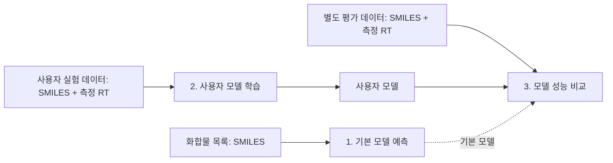

# MDCC Retip: 무엇을 입력하고, 무엇을 학습하며, 결과를 어떻게 읽는가

## 한눈에 보기

MDCC Retip은 화합물 구조식(SMILES)과 액체크로마토그래피 retention time(RT)을 다루는 도구입니다. RP(reverse phase)와 HILIC 분리 모드를 지원합니다.



| 모듈 | 사용 목적 | 넣는 데이터 | 받는 결과 |
|---|---|---|---|
| 1. `predict` | 내장 기본 모델로 RT를 빠르게 추정 | SMILES 목록 | 화합물별 예상 RT |
| 2. `train` | 내 실험 조건의 RT 라이브러리로 모델 생성 | SMILES + 내가 측정한 RT | 사용자 전용 예측 모델 |
| 3. `compare` | 같은 평가 데이터에서 기본/사용자 모델 성능 확인 | SMILES + 측정 RT + 사용자 모델 | RMSE, MAE, R²와 비교 그림 |

## 입력 데이터

### 1. 예측용 화합물 목록

최소한 `SMILES` 열이 필요합니다. RP와 HILIC를 한 파일에 섞으면 각 행에 `model_type`을 넣습니다.

```csv
compound_id,SMILES,model_type
C001,Cn1c(=O)c2c(ncn2C)n(C)c1=O,RP
C002,O=C(O)c1ccccc1,HILIC
```

`SMILES`는 필수이고, `model_type`은 명령어의 `--model RP` 또는 `--model HILIC`로 대체할 수 있습니다. `compound_id`, `Name`은 결과 식별용 선택 항목입니다. 이 단계에서는 실험 RT가 없어도 됩니다.

### 2. 사용자 모델 학습용 실험 데이터

사용자 LC 조건에서 직접 측정한 RT 표가 필요합니다.

```csv
compound_id,SMILES,RT
S001,CCO,2.10
S002,CCN,2.80
S003,O=C(O)c1ccccc1,5.40
```

`SMILES`와 `RT`(또는 `experimental_rt`)는 필수입니다. RP/HILIC은 열 또는 `--model`로 지정합니다. 정제 후 최소 25행과 서로 다른 구조 15개가 필요합니다. 같은 컬럼, 이동상, gradient, RT 단위로 측정한 데이터를 사용해야 합니다.

### 3. 모델 평가용 데이터

이 단계는 새 모델을 학습하지 않습니다. 측정 RT가 있는 **별도 평가 표**와 사용자 모델을 넣어 모델 오차를 계산합니다. 가장 안전한 입력은 2번 단계가 만든 `reserved_test.csv`입니다. 이 데이터는 학습과 validation에 쓰이지 않아, 학습 데이터를 다시 평가해 점수가 과도하게 좋아지는 문제를 피합니다.

## 내부 처리

1. SMILES를 RDKit으로 읽어 분자량·극성·고리 수 등의 구조 descriptor로 변환합니다.
2. `predict`는 번들된 RP/HILIC 기본 best model로 RT를 계산합니다.
3. `train`은 같은 구조가 train/validation/test에 섞이지 않도록 구조 단위로 분할합니다. train 데이터에서만 전처리와 feature selection을 학습하고 validation RMSE로 best 모델을 고릅니다.
4. `compare`는 동일 평가 행에 각 모델을 적용해 MAE, RMSE, R²를 계산합니다. 사용자 모델의 학습/validation 구조가 평가 데이터에 있으면 누수로 보고 중단합니다.

## 결과 읽는 법

### 예측 결과: `results/.../predictions.csv`

| 열 | 의미 |
|---|---|
| `predicted_rt` | 모델이 예측한 RT |
| `best_model` | 해당 행에 사용한 내장 모델 |
| `parse_status` | `ok`: 구조 해석 성공, `invalid_smiles`: 구조가 잘못되었거나 비어 있음 |
| `warning_message` | 예측하지 못한 이유 |

`report.html`은 사람이 보는 표/그림 보고서이고, `manifest.json`은 입력 해시·모델·런타임 버전을 기록합니다. 예제 `compounds.csv`의 8행 중 2행은 의도적으로 invalid/빈 SMILES입니다. 따라서 이 2행에 수치가 없고 `invalid_smiles`로 남는 것은 정상입니다.

### 학습 결과: `results/.../02_train_rp`

| 파일 | 확인할 내용 |
|---|---|
| `model/` | 이후 예측/비교에 쓰는 사용자 모델 묶음 |
| `validation_leaderboard.csv` | 후보 모델 validation 성능. `score_val`은 음수 RMSE이므로 0에 가까울수록 좋음 |
| `reserved_test.csv` | 모델 선택에 쓰지 않은 평가용 행 |
| `split_assignments.csv` | 각 입력 행의 train/validation/reserved_test 배정 |
| `rejected_rows.csv` | 잘못된 SMILES 등 제외된 행 |

best 모델은 reserved test가 아니라 validation RMSE로 선택됩니다. 이는 test를 보고 모델을 고르는 데이터 누수를 막기 위한 설계입니다.

### 비교 결과: `results/.../03_compare_rp/comparison.csv`

| 지표 | 해석 |
|---|---|
| `n` | 오차 계산에 쓴 유효 평가 화합물 수. 모델끼리 같아야 공정한 비교 |
| `MAE` | 평균 절대 오차. 작을수록 좋음 |
| `RMSE` | 큰 오차에 더 민감한 오차. 작을수록 좋음 |
| `R²` | 1에 가까울수록 좋음. 0 이하이면 단순 평균 예측보다도 나쁠 수 있음 |
| `selected_best` | 각 모델 묶음에서 저장된 best 모델인지 여부 |

`comparison.png`과 `report.html`은 모델별 오차와 관측 RT 대비 예측 RT를 시각적으로 보여 줍니다.

## 예제 결과 해석의 주의점

`examples/synthetic_training_RP.csv`와 `synthetic_training_HILIC.csv`의 RT는 **합성값**입니다. 명령어와 입출력 흐름을 확인하기 위한 예제이지 실제 LC 분석 성능 평가용 데이터가 아닙니다.

따라서 예제에서 사용자 모델의 R²가 높거나 기본 모델보다 낮은 RMSE가 나와도 실제 성능 우수성을 뜻하지 않습니다. 실제 성능을 주장하려면 학습에 쓰지 않은 실측 데이터, 동일하거나 비교 가능한 LC 조건, 동일 RT 단위, 충분한 표본과 구조 다양성이 필요합니다.

## 정상 실행 확인

PowerShell에서 각 명령 직후 `$LASTEXITCODE`가 `0`인지 확인하고, 각 output 폴더에 CSV, HTML, PNG, `manifest.json`이 생성됐는지 확인합니다.

```powershell
$LASTEXITCODE
Get-ChildItem results\01_predict
Get-ChildItem results\02_train_rp
Get-ChildItem results\03_compare_rp
Import-Csv results\03_compare_rp\comparison.csv | Format-Table
```

이는 Windows Python 기반 검증입니다. CLOSHA 제출 전 최종 검증은 Apptainer가 설치된 Linux에서 세 `.def`를 SIF로 build하고 `apptainer test` 및 동일 예제를 실행하는 것입니다.

## 설치 확인

새 가상환경 또는 새 컨테이너에서 requirements 설치 후 `python -m mdcc.cli predict --help`로 CLI import를 먼저 확인하는 것을 권장합니다.
